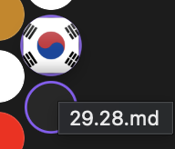

# Week Life Circles

A life-in-weeks grid journal for [Obsidian](https://obsidian.md).

Your life is drawn as a grid of circles: 52 weeks down, one column per year of
your life. Every circle is one week. Write a note for a week, give it a color
("what kind of week was it?"), and the circle fills in. Click a filled circle to
open its note; click an empty one to create it. A second view does the same for
single days.

## Screenshots

**The week grid** — one circle per week of your life, colored by what kind of week it was, with image squares for trips and milestones:


**Creating a week note** — pick a square, and optionally attach photos (including from an Immich server):


**Every circle links to its note:**




## How it counts

Weeks are *personal*, not calendar weeks: year `28`, week `01` starts on your
28th birthday. Each personal year has 52 weeks (the last one absorbs the extra
day or two). That is why the plugin needs your birth date before it shows anything.

## Features

- **Week grid** — every week of your life from a start age to an end age, as a
  staggered grid of circles. The current week pulses. Rows and columns can be swapped.
- **Day grid** — the next ten personal years, one circle per day.
- **Squares** — each note carries one colored square (or a small image, e.g. a
  flag for a trip). The set of squares is yours to edit: add, remove, pick colors.
- **One-click notes** — clicking an empty circle opens a dialog: pick the square,
  optionally attach photos or videos, and the note is created from your template.
- **Multi-week notes** — one note can cover several weeks (`03-05.28` in its
  first lines, with one square per week).
- **Templates** — the week and day note templates are plain text in the settings.
- **Works on mobile** — including a floating button to open the grid.
- **Optional Immich photo picker** — see below. Off by default.

## Getting started

1. Install and enable the plugin.
2. Open **Settings → Week Life Circles** and enter your **birth date** (`YYYY-MM-DD`).
3. Open the grid: the ribbon icon, or the command **Open week calendar**.
4. Click the current week and create your first note.

## Where notes live

| What | Path (defaults) |
| --- | --- |
| Week note | `Week life calendar/28/07.28.md` (week `07` of personal year `28`) |
| Week attachments | `Week life calendar/Attachments/28/07.28.jpg`, `07_2.28.jpg`, … |
| Day note | `Week day status/07.28/2026-11-18.md` |

The square is read from the first lines of the note — a line such as
`07.28 <span class="sq sq-work"></span> 18.11.2026`. Image squares are written as
an embed: `![[england.png|14]]`.

## Settings

| Setting | What it does |
| --- | --- |
| Birth date | Anchor of the whole grid. Nothing is shown until it is set. |
| Start age / End age | First and last personal year shown in the week grid. |
| Week folder / Day folder | Where week and day notes are stored. |
| Day template path | Optional path to a note used as the day template instead of the built-in one. The same placeholders work in it. |
| Week template / Day template | Text of new notes. Placeholders: `{{ww}}`, `{{yy}}`, `{{square}}`, `{{date}}`, `{{photos}}` (week), `{{weekday}}` (day). The weekday is written in Obsidian's language. |
| Squares | The list of squares: a name plus either a color or an image file in your vault. |
| Immich | Optional photo picker, see below. |
| Configuration | **Export** copies all settings as one code; **Import** applies a pasted code, or fetches one from a URL you paste. Good for setting up a second device. |

## Import / export configuration

Set up another device (e.g. a phone) without re-typing everything: on the
already-configured device, go to **Settings → Week Life Circles → Configuration
→ Copy config code**. On the other device, paste it into **Import config** and
press Apply — every setting fills in.

The code is base64 of your settings and **includes your Immich API key**, so
treat it like a password. You can also paste a **URL** that returns the config
(raw JSON, or the same code) — the plugin fetches it only when you press Apply
(see the network disclosure below).

## Commands

- **Open week calendar**
- **Open day calendar**
- **Create next week file** — the week after the last one you wrote this year
- **Create week file** — any week, by number

## Optional Immich integration (network use)

If you run your own [Immich](https://immich.app) photo server, the "Create week
file" dialog can show that week's photos so you can pick some to attach.

**Disclosure.** The plugin touches the network in only two places, and each runs
*only* when you ask: this Immich picker, and **Import config** when you paste a
URL (it fetches that URL's text and reads it as your settings). There is no
telemetry and nothing is ever sent to the plugin author. For Immich specifically:

- It is **off by default**. Nothing is contacted until you enable it and enter a
  server URL and an API key.
- Requests go **only to the server URL you enter** — never to the plugin author
  or any third party. There is no telemetry.
- What is sent: your API key (as the `x-api-key` header) and the date range of
  the week you are creating. What is fetched: the list of assets in that range,
  their thumbnails, and the photos or videos you select, which are saved into
  your vault.
- The API key is stored in the plugin's `data.json` inside your vault, in plain
  text. Use a key with read-only permissions, and keep it in mind if you sync or
  share the vault.

Without Immich you can still attach photos by dropping files into the dialog.

## Installing manually

Download `main.js`, `manifest.json` and `styles.css` from the latest release and
put them in `<vault>/.obsidian/plugins/week-life-circles/`.

## Development

```
npm install
npm test        # unit tests (calendar math, parsing, templates, migration)
npm run build   # type-check and bundle to main.js
```

## License

[MIT](LICENSE)
