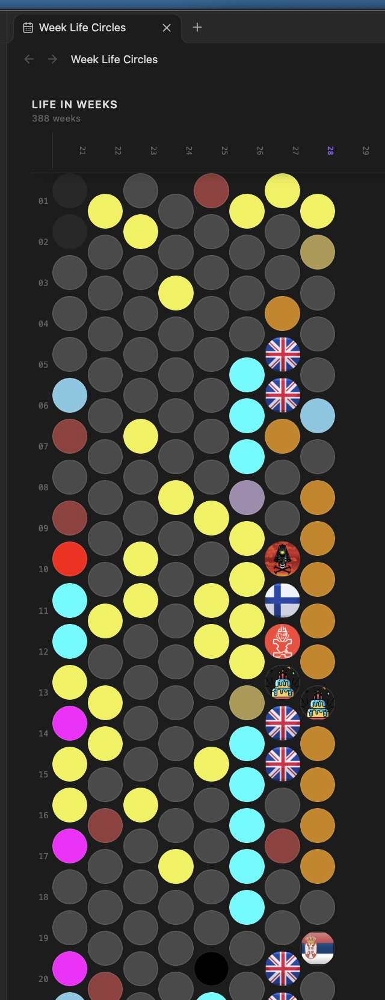
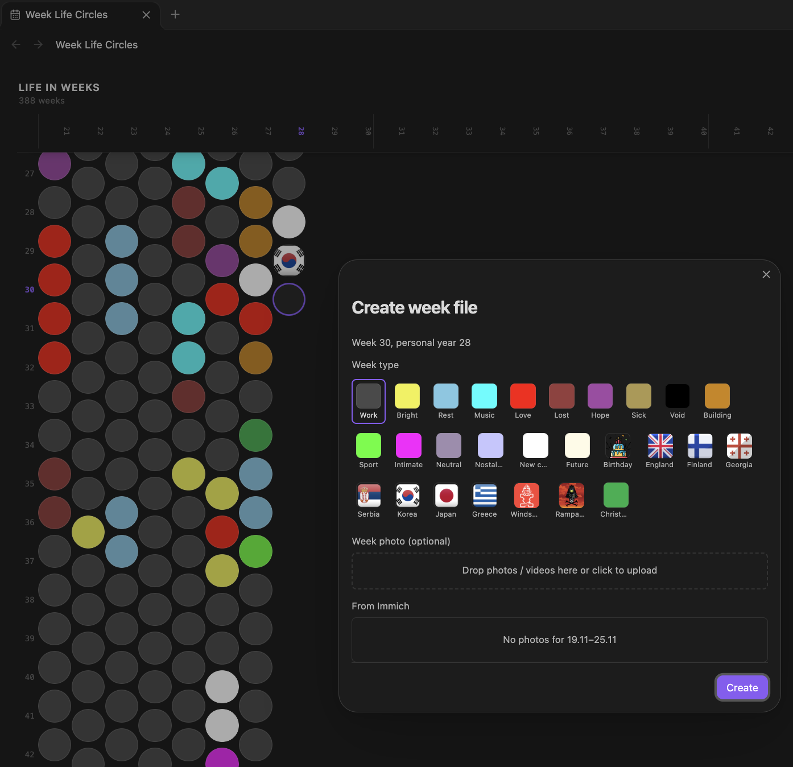

# Week Life Circles

A life-in-weeks journal for [Obsidian](https://obsidian.md) · **[week.dth.ink](https://week.dth.ink)**

Week Life Circles draws your life as a grid: 52 weeks down, one column per year, one circle per week. Write a note for a week, choose what kind of week it was, and its circle fills in with that colour or a small image. Click a filled circle to open its note, or an empty one to create it. A second view does the same for single days, and every note is a plain Markdown file in your vault.

## Screenshots

**The week grid** — one circle per week of your life, colored by what kind of week it was, with image circles for trips and milestones:



**Creating a week note** — pick a circle, and optionally attach photos (including from an Immich server):



**Every circle links to its note:**


## How it counts

Weeks are *personal*, not calendar weeks: by default year `28`, week `01` starts on your
28th birthday. Each personal year has 52 weeks (the last one absorbs the extra
day or two). That is why the plugin needs your birth date before it shows anything.

Prefer a calendar-style grid? **Year starts** lets each year begin on your birthday
(default), on 1 January, or on any day you choose (e.g. 1 September for a school year).

## Features

- **Week grid** — every week of your life from a start age to an end age, as a
  staggered grid of circles. The current week pulses. Rows and columns can be swapped.
- **Day grid** — the next ten personal years, one circle per day. The row
  labels show the calendar date (the month's short name on the 1st), and each
  month's 1st is marked in every column (a thin ring in the honeycomb, a line in the aligned views).
- **Three views** — the first button at the top right of the grid switches
  between circles in a honeycomb (the default), squares in a plain aligned grid
  like the classic "life in weeks" poster, and circles in that same aligned grid.
  The choice applies to both grids and is remembered.
- **Circles** — each note carries one colored circle (or a small image, e.g. a
  flag for a trip). The set of circles is yours to edit in the settings: rename,
  recolor, reorder, delete, and upload images straight from your device (or pick
  one already in your vault) — with a live preview in your cell shape. Days can
  have a separate set of circles of their own.
- **Hover preview** — hovering a filled circle opens Obsidian's own note popover (the one links show), rendered with headings and photos, so you can recall a week without opening it. It uses the core *Page preview* plugin; in its settings, *Week Life Circles* can be set to require Cmd/Ctrl.
- **One-click notes** — clicking an empty circle opens a dialog: pick the circle,
  optionally attach photos or videos (uploaded, or picked from a photo folder in your vault
  by the week's dates), and the note is created from your template.
- **Circle as a property** — new notes can record their circle as a frontmatter
  property (`circle: work`), so Bases, Dataview and search can use it. The command
  **Add circle properties to existing notes** adds it to older notes (after a dry run).
- **Multi-week notes** — one note can cover several weeks (`03-05.28` in its
  first lines, with one circle per week).
- **Templates** — the week and day note templates are plain text in the settings,
  with starter templates (Minimal, Journal, Reflection) in English, Ukrainian and Polish.
  A new install starts with the Journal template in your language. Dates are written in
  the format you choose.
- **Works on mobile** — including a floating button to open the grid. On a
  narrow screen the year columns page by decade: swipe sideways to flip exactly
  ten years (20–29, 30–39, …), scroll up and down as usual. The cells shrink a
  little so a whole decade fits the screen.
- **Follows your theme** — light or dark; every filled circle has a subtle
  contrasting ring, so white circles stay visible on a light background and
  black ones on a dark background.
- **English, Ukrainian, Polish** — the interface follows Obsidian's language, or the one you
  pick in the settings.
- **Optional Immich photo picker** — see below. Off by default.

## Getting started

1. Install and enable the plugin.
2. Open **Settings → Week Life Circles** and enter your **birth date** (`YYYY-MM-DD`)
   (until then the grid shows an **Open settings** button).
3. Open the grid: the ribbon icon, or the command **Open week calendar**.
4. Click the current week and create your first note.

## Where notes live

| What | Path (defaults) |
| --- | --- |
| Week note | `Week life calendar/28/07.28.md` (week `07` of personal year `28`) |
| Week attachments | Obsidian's attachment location (**Settings → Files and links**), named `07.28.jpg`, `07_2.28.jpg`, …; or `Week life calendar/Attachments/28/07.28.jpg` with **Photo location → Week folder** |
| Day note | `Week day status/2026-11-18.md`; with **Day note layout** also `Week day status/07.28/2026-11-18.md` (per week) or `Week day status/2026/11/2026-11-18.md` (per month) |

Installs from 1.9 or earlier keep the per-week day folders and the `Attachments/YY` photo
folder. Day notes are found anywhere inside the day folder, so a layout change never hides
older notes, and the day folder can be the core **Daily notes** folder.

The circle is read from the note's frontmatter property first (`circle` by default):

- one circle: `circle: work`
- a note covering several weeks, one circle per week in order: `circle: [work, trip]`, or
  the block list Obsidian writes (`circle:` followed by `  - work` and `  - trip` lines)

A value names a circle by its key base name (`work` for `work.png`), its full key, or its
display name, ignoring case; values that match no circle are ignored. Without a matching
property, the circle is read from the first lines of the note — a line such as
`07.28 <span class="sq sq-work"></span> 18.11.2026`. Image circles are written as
an embed: `![[england.png|14]]`.

**Add circle properties to existing notes** (command palette) scans the week and day
folders, shows how many notes have a marker but no property plus five examples, and only
after you confirm adds the property (via Obsidian's frontmatter API). The markers in the
text are kept. Notes that already have the property, or whose marker is not one of your
circles (an old-style embed may be a photo), are left alone; running it again is safe.

## Settings

| Setting | What it does |
| --- | --- |
| Language | Auto (follows Obsidian), English, Ukrainian or Polish: the settings, dialogs, buttons and notices. A language you pick also sets the month and weekday names; on Auto they follow Obsidian. Command names update after reloading the plugin. |
| Birth date | Needed before anything is shown; the default start of every grid year. |
| Year starts | On your birthday (default), on 1 January, or on a custom day (`MM-DD`). Existing notes keep their week/year numbers, so after a change they map to different dates. |
| Start from year | The first year of the week grid: the current year (default, moves forward on its own) or any year from 0 (your whole life) up to now. Notes from earlier years stay in your vault. |
| End age | Last personal year shown in the week grid. |
| Day grid years | How many years the day grid shows side by side, 1–30 (default 10). |
| Floating button on mobile | The round button that opens the grid (default on). |
| Week folder / Day folder | Where week and day notes are stored. |
| Day note layout | Where new day notes go inside the day folder: all in the folder (`YYYY-MM-DD.md`, default for new installs), a folder per week (`WW.YY/`, kept by installs from 1.9 or earlier) or per month (`YYYY/MM/`). |
| Photo location | Where photos uploaded with a new week go: Obsidian's attachment location (default for new installs) or `<week folder>/Attachments/YY/` (kept by installs from 1.9 or earlier). |
| Photo width | Display width of embedded photos, default `600` px; `0` = no width (full size). Videos are embedded without one. |
| Photo folder in the vault | Off when empty. When set, the new week dialog lists the photos and videos in this folder (and its subfolders) taken that week — the date comes from `YYYY-MM-DD` or `YYYYMMDD` in the file name (e.g. `IMG_20261118_0930.jpg`), else from the file's creation date. Picked files are embedded where they are, not copied. |
| Week template path / Day template path | Optional path to a note used as the week or day template instead of the built-in one. The same `{{…}}` placeholders work in it (Templater tags are not interpreted by this plugin, except with **Old template compatibility**). |
| Old template compatibility | Off for new installs, on for installs from 1.9 or earlier (and data moved over from the old week-calendar-sync plugin). When on, template *files* work as before 1.10: in the day template file the Templater tags `<% date %>`, `<% dayUA %>` and the `-1` (yesterday) tag are filled in (as `YYYY-MM-DD` / the weekday), the first `<%* … %>` block is removed, the literal `<span class="sq sq-work"></span>` becomes the chosen circle, and `{{date}}` is written as `YYYY-MM-DD`; in the week template file `{{date}}` is the creation date. Turn it off once your template files use the `{{…}}` placeholders. |
| Date format | How dates are written into new notes, as a [moment.js format](https://momentjs.com/docs/#/displaying/format/) — default `DD.MM.YYYY`. Day note file names always stay `YYYY-MM-DD.md`. |
| Week template / Day template | Text of new notes; see the placeholders below. |
| Starter template | Pick Minimal, Journal or Reflection and **Load** it to replace the week template (after a confirmation), in the plugin's current language. |
| Marker shape in notes | Circle (default for new installs) or rounded square: how the marker at the top of a week/day note is drawn. Colour and image markers always share one size and shape. |
| Circle in notes | How a new note records its circle: **Marker in the text** (the span/embed at the top), **Property** (frontmatter only; `{{circle}}` then renders empty) or **Both** (default for new installs; installs from 1.9 or earlier keep the marker only). The grid reads either. |
| Circle property | Name of that frontmatter property, default `circle`. |
| Circles | **Restore defaults** brings back the seven default circles in one click. The list of circles, previewed in your cell shape. Each is a name plus a color, or an image. Rename, recolor, reorder (the first one is preselected for new notes) or delete them; **Replace image** uploads a new picture under the same file name, so existing notes keep working. A colour circle can become an image circle (upload or pick a picture) and back again; notes that already use it follow along and show its new look. **Add a circle**: pick a color, or upload an image (shrunk to a small PNG and saved to your attachments folder) or choose a PNG/JPG already in your vault. |
| Separate circles for days | Off by default. When on, a second circle list (**Day circles**, edited the same way) is used by day notes, the day grid and the new-day dialog; week notes keep the circles above. The day list starts as a copy of your circles at the time of the upgrade (the seven defaults on a new install), so day notes you already have keep their circles. Markers of both lists are coloured inside notes. |
| Immich | Optional photo picker, see below. |
| Configuration | **Export** copies all settings as one code; **Import** applies a pasted code, or fetches one from a URL you paste. Good for setting up a second device. |

## Template placeholders

| Placeholder | Week note | Day note |
| --- | --- | --- |
| `{{ww}}`, `{{yy}}` | week number (`07`) and personal year (`28`) | — |
| `{{circle}}` (`{{square}}` still works) | the week's circle (empty when *Circle in notes* is Property) | the day's circle (same) |
| `{{date}}` | first day of the week | the day |
| `{{weekEnd}}` | last day of the week (week 52 runs up to the next year start) | — |
| `{{today}}` | the day the note is created | the day the note is created |
| `{{yesterday}}` | — | the day before |
| `{{weekday}}` | — | weekday name |
| `{{days}}` | one line per day of the week: `- Wed 18.11.2026 — ` (7 lines; week 52 may have 8–9) | — |
| `{{photos}}` | embeds of the attached photos/videos | — |

Dates use the **Date format** setting; one placeholder can carry its own format, e.g.
`{{date:YYYY-MM-DD}}` or `{{today:D MMMM}}`. Weekday and month names are written in Obsidian's
language, or in the plugin's language if you picked one.

Upgrading from 1.9 or earlier: `{{date}}` used to be the creation date in week notes and
`YYYY-MM-DD` in day notes. Your saved templates are rewritten once (`{{date}}` → `{{today}}` in
the week template, → `{{date:YYYY-MM-DD}}` in the day template), so new notes look as before.
Template *files* are not rewritten; **Old template compatibility** (on for upgraded installs)
keeps them working as before until you turn it off.

**Update the plugin on every synced device.** An older version still running on another device
drops the new settings when it saves, and would write `{{today}}` literally into new notes.

## Import / export configuration

Set up another device (e.g. a phone) without re-typing everything: on the
already-configured device, go to **Settings → Week Life Circles → Configuration
→ Copy config code**. On the other device, paste it into **Import config** and
press Apply — every setting fills in (both circle lists included).

The code is base64 of your settings and **includes your Immich API key**, so
treat it like a password. You can also paste a **URL** that returns the config
(raw JSON, or the same code) — the plugin fetches it only when you press Apply
(see the network disclosure below).

## Commands

- **Open week calendar**
- **Open day calendar**
- **Create next week file** — the week after the last one you wrote this year
- **Create week file** — any week, by number

## Optional Immich integration (network use)

If you run your own [Immich](https://immich.app) photo server, the "Create week
file" dialog can show that week's photos so you can pick some to attach.

**Disclosure.** The plugin touches the network in only two places, and each runs
*only* when you ask: this Immich picker, and **Import config** when you paste a
URL (it fetches that URL's text and reads it as your settings). There is no
telemetry and nothing is ever sent to the plugin author. For Immich specifically:

- It is **off by default**. Nothing is contacted until you enable it and enter a
  server URL and an API key.
- Requests go **only to the server URL you enter** — never to the plugin author
  or any third party. There is no telemetry.
- What is sent: your API key (as the `x-api-key` header) and the date range of
  the week you are creating. What is fetched: the list of assets in that range,
  their thumbnails, and the photos or videos you select, which are saved into
  your vault.
- The API key is stored in the plugin's `data.json` inside your vault, in plain
  text. Use a key with read-only permissions, and keep it in mind if you sync or
  share the vault.

Without Immich you can still attach photos by dropping files into the dialog.

## Installing manually

Download `main.js`, `manifest.json` and `styles.css` from the latest release and
put them in `<vault>/.obsidian/plugins/week-life-circles/`.

## Development

```
npm install
npm test        # unit tests (calendar math, parsing, templates, migration)
npm run build   # type-check and bundle to main.js
```

## License

[MIT](LICENSE)
